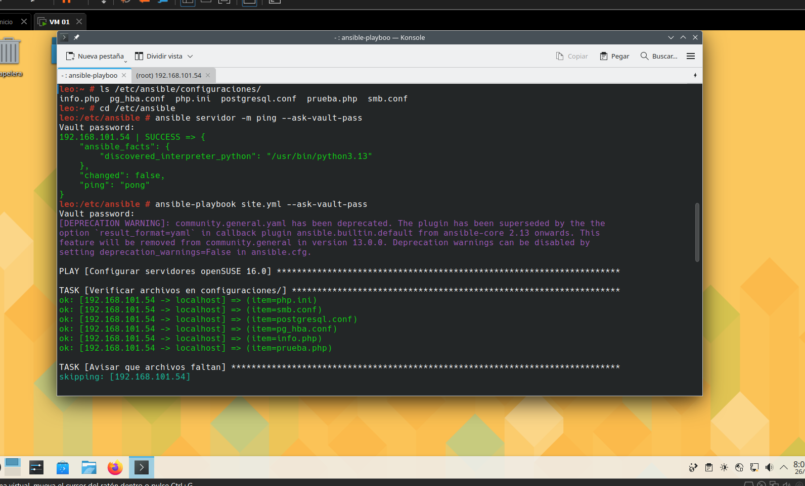
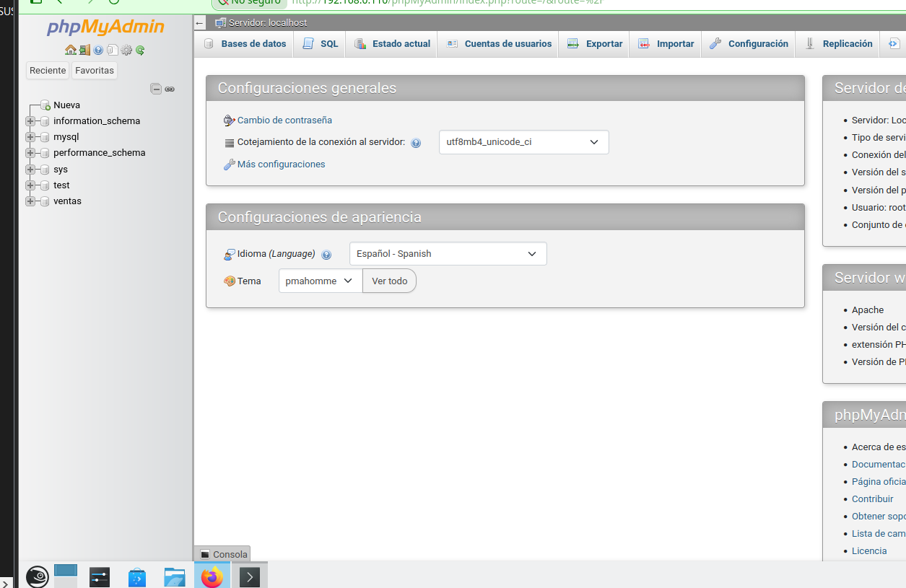
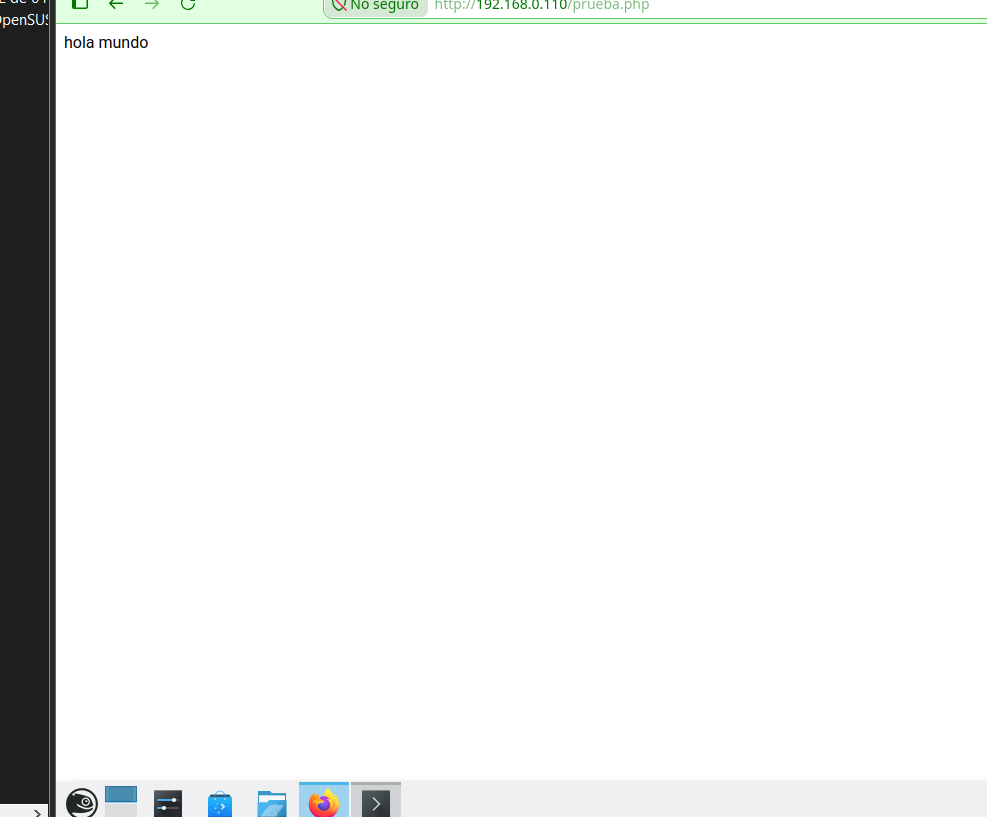
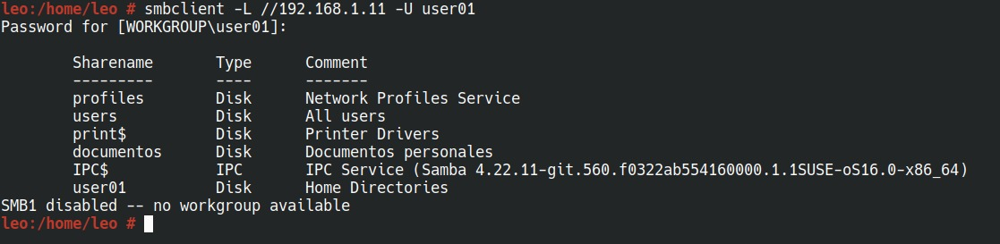
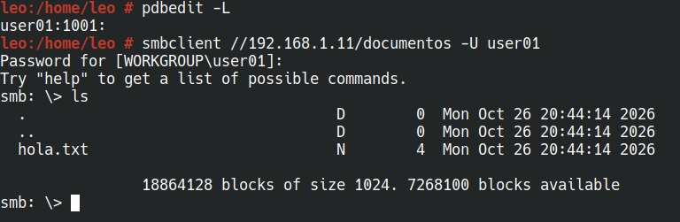
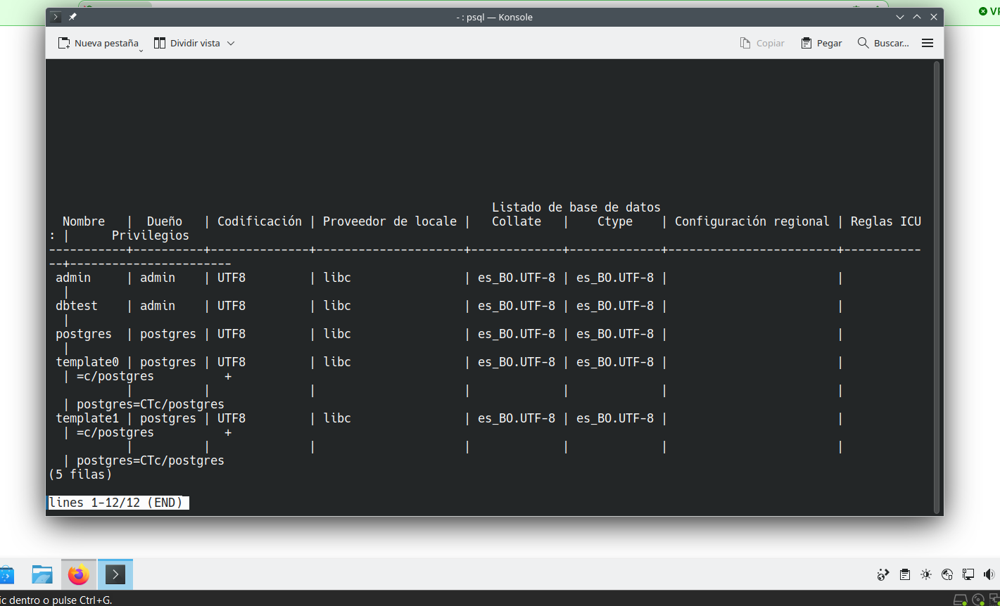

<div align="center">

# ☁️ Ansible ASO

### 🛠️ Automatización de LAMP, Samba y PostgreSQL en openSUSE 16.0


<br>

<p>
  
  
  
</p>

<p>
  
  
  
</p>

</div>

## 👥 Equipo de Trabajo

<!-- 📷 FOTOS 2, 3, 4, 5: una foto por integrante -> assets/leonardo.jpeg, integrante2.jpg, integrante3.jpg, integrante4.jpg -->

<table>
<tr>

<td width="50%" valign="middle">
<table><tr>
<td align="center" valign="middle"></td>
<td valign="middle">

**🧑‍💻 Leonardo Mena**<br>
Grupo 1<br>
🎓 Codsis: 202201743<br>
📱 +591 69588990

</td>
</tr></table>
</td>

<td width="50%" valign="middle">
<table><tr>
<td align="center" valign="middle"></td>
<td valign="middle">

**🧑‍🎨 Dylan Temprano**<br>
Grupo 1<br>
🎓 Codsis: 202201667<br>
📱 +591 71426919

</td>
</tr></table>
</td>

</tr>
<tr>

<td width="50%" valign="middle">
<table><tr>
<td align="center" valign="middle"></td>
<td valign="middle">

**⚙️ Areacely Alcon**<br>
Grupo 1<br>
🎓 Codsis: 202501435<br>
📱 +591 75965338

</td>
</tr></table>
</td>

<td width="50%" valign="middle">
<table><tr>
<td align="center" valign="middle"></td>
<td valign="middle">

**🧩 Sergio Arancibia**<br>
Grupo 1<br>
🎓 Codsis: 201702027<br>
📱 +591 79757761

</td>
</tr></table>
</td>

</tr>
</table>

---

## 📖 Descripción del Proyecto

Proyecto de **Ansible** que configura de forma remota, desde una máquina Master (VM 01), las demás máquinas virtuales con **openSUSE 16.0**.

Se organiza en **roles**, uno por servicio:

| Rol | Qué configura |
|---|---|
| 🌐 `lamp` | Apache, PHP 8, phpMyAdmin y MariaDB (clave de root, base `ventas`, tabla `emp`) |
| 📁 `samba` | Usuario del sistema, usuario de Samba, directorio compartido y `create mask` |
| 🐘 `postgresql` | PostgreSQL, `php8-pgsql`, clave de `postgres`, usuario nuevo, conexiones remotas y clave cifrada |

---

## ✅ Tareas cubiertas

| Tarea | Descripción | Dónde está |
|---|---|---|
| **Tarea 3** | LAMP y Samba con roles, inventario sin contraseñas y optimización | `roles/lamp`, `roles/samba`, `ansible.cfg`, `group_vars/` |
| **Tarea 4** | Scripts y archivos de configuración en GitHub | Este repositorio |
| **Tarea 5** | Rol de PostgreSQL | `roles/postgresql` |

---

## 🧱 Estructura del Proyecto

```text
.
├── ansible.cfg              → Configuración y optimización
├── site.yml                 → Playbook principal
├── inventory/
│   └── hosts.ini            → Solo las IP de las máquinas
├── group_vars/servidor/
│   ├── vars.yml             → Variables (sin contraseñas)
│   └── vault.yml            → Contraseñas cifradas (ansible-vault)
├── configuraciones/         → Archivos de configuración a copiar
│   ├── php.ini
│   ├── smb.conf
│   ├── postgresql.conf
│   ├── pg_hba.conf
│   ├── info.php
│   └── prueba.php
└── roles/
    ├── lamp/
    ├── samba/
    └── postgresql/
```

---

## ⚡ Optimización

| Cambio | Para qué sirve |
|---|---|
| 🔐 `ansible-vault` | Las contraseñas no quedan a la vista en el inventario |
| 🧑‍🤝‍🧑 `forks = 10` | Trabaja con 10 máquinas a la vez |
| 🚫 `gather_facts: false` | No recolecta datos innecesarios al iniciar |
| 📦 `pipelining = True` | Menos pasos por SSH en cada tarea |
| 🔁 `ControlPersist=60s` | Reutiliza la conexión SSH en vez de abrir una por tarea |
| 🏃 `strategy: free` | Cada máquina avanza a su ritmo, sin esperar a la más lenta |
| ⏱️ `timeout = 5` y `ConnectTimeout=5` | Una IP caída falla en 5 segundos y sin reintentos (`ConnectionAttempts=1`) |
| 🤝 `host_key_checking = False` | No pregunta "¿confías en esta máquina?" al conectar por primera vez |
| 🧰 Paquetes en una sola tarea | Cada rol instala todos sus paquetes con un solo `zypper` |
| 🔔 `handlers` (`notify`) | Al copiar un archivo de configuración se avisa al handler que reinicia el servicio |

---

## 🛠️ Tecnologías Utilizadas

<div align="center">


</div>

---

## 🖼️ Vista previa

<!-- 📷 FOTOS 6 a 10: capturas de pantalla del proyecto funcionando -> carpeta assets/ -->

### ▶️ Ejecución del playbook

<!-- 📷 FOTO 6: terminal con el resultado final (PLAY RECAP con failed=0) -> assets/playbook.png -->
<div align="center">
  
</div>

### 🌐 LAMP funcionando

<!-- 📷 FOTO 7: navegador en http://IP/info.php -> assets/info-php.png -->
<!-- 📷 FOTO 8: navegador en http://IP/phpMyAdmin mostrando la base ventas -> assets/phpmyadmin.png -->
<div align="center">
  
  
</div>

### 📁 Samba funcionando

<!-- 📷 FOTO 9: terminal con smbclient -L //IP -U user01 -> assets/samba.png -->
<div align="center">
  
  
</div>

### 🐘 PostgreSQL remoto funcionando

<!-- 📷 FOTO 10: terminal con psql -U postgres -h IP desde otra máquina -> assets/postgresql.png -->
<div align="center">
  
</div>

---

## 🚀 Cómo ejecutar el proyecto

### 📥 1. En la VM 01 (Master)

En la VM 02 solo hace falta `sshd`, `firewalld` y el acceso root.

```bash
zypper install ansible sshpass git unzip openssh-server-config-rootlogin
systemctl start sshd
systemctl disable firewalld
```

### 📂 2. Copiar el proyecto a `/etc/ansible` y entrar

Elegir **una** de las dos opciones.

#### 📦 Opción A — Descargando el ZIP

En GitHub: botón **Code > Download ZIP** y dejar el archivo en la VM 01.

```bash
unzip ansible-aso-lamp-samba-main.zip
mkdir -p /etc/ansible
cp -r ansible-aso-lamp-samba-main/. /etc/ansible/
cd /etc/ansible
```

#### 🐙 Opción B — Con Git

```bash
git clone https://github.com/Tempra123/ansible-aso-lamp-samba.git
mkdir -p /etc/ansible
cp -r ansible-aso-lamp-samba/. /etc/ansible/
cd /etc/ansible
```

### 🌐 3. Poner las IP de las máquinas

Editar `inventory/hosts.ini`.

### 🔑 4. Acceso SSH sin contraseña

```bash
ssh-keygen -t ed25519
ssh-copy-id root@IP_DE_CADA_MAQUINA
```

### 🔐 5. Poner las contraseñas y cifrarlas

Editar `group_vars/servidor/vault.yml` y cifrarlo:

```bash
vim group_vars/servidor/vault.yml
ansible-vault encrypt group_vars/servidor/vault.yml
```

### ▶️ 6. Ejecutar

Siempre desde `/etc/ansible`.

Todo:

```bash
ansible-playbook site.yml --ask-vault-pass
```

Solo un rol:

```bash
ansible-playbook site.yml --tags lamp --ask-vault-pass
ansible-playbook site.yml --tags samba --ask-vault-pass
ansible-playbook site.yml --tags postgresql --ask-vault-pass
```

---

<div align="center">

**🚀 Práctica de Ansible grupal — ASO**<br>
👥 Trabajo en equipo<br>
✨ openSUSE 16.0 · 2026

</div>
